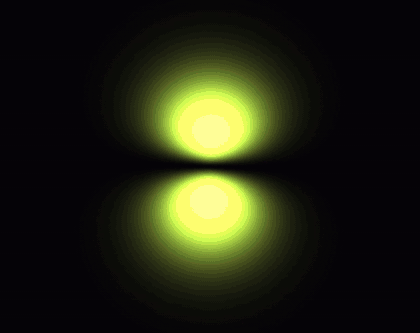
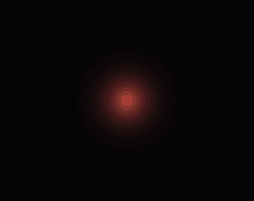

# ElectronCloud

What does an electron "look like"? ElectronCloud ray-marches the probability cloud of a
hydrogen atom's electron on the GPU with CUDA, and animates the electron moving between
orbitals when it is driven by light.

## Examples

**2p<sub>z</sub> &rarr; 3d<sub>z&sup2;</sub>, seen from above.** Weaker light (1.75 &times; 10<sup>10</sup> W/cm&sup2;) makes the
transition slower, so the charge sloshes back and forth 20 times on the way &mdash; the
oscillating dipole that absorbs the light.

[](docs/media/2p_to_3d_top_sloshing.mp4)

```sh
./run --record out.mp4 --from 2p_z --to 3d_z2 --elevation 89 --intensity 1.75e10
```

**1s &rarr; 2p<sub>z</sub>**, the default recording: hydrogen's ground state driven into its first
excited state.

[](docs/media/1s_to_2p.mp4)

```sh
./run --record out.mp4
```

The previews are cropped, 12 fps GIFs; click one for the full 1080p60 video (or open
[`docs/media/`](docs/media/)).

## What it draws

- **Orbitals:** every hydrogen orbital up to n = 3 (1s, 2s, 2p, 3s, 3p, 3d), real-valued
  wave functions &psi;<sub>nlm</sub>(r, &theta;, &phi;), each normalised and checked numerically.
  The density is |&psi;|&sup2;.
- **Rendering:** one ray per pixel, marched through the cloud with emission and absorption
  that are both linear in density, so brightness differences between regions stay faithful.
  Density is scaled to each orbital's peak so faint orbitals stay visible. Each orbital has
  its own colour.
- **Transitions:** resonant light drives the electron from one orbital to another (Rabi
  oscillation). The density is
  `cos²(Ωt/2) ψ_A² + sin²(Ωt/2) ψ_B² − sin(Ωt) sin(ω₀t) ψ_A ψ_B`: the populations move
  from A to B while the last term makes the cloud slosh at the transition frequency.
  Everything is physical except playback speed &mdash; the laser intensity sets how fast the
  transition goes and how many times the cloud sloshes; dipole selection rules are computed
  from the wave functions, and forbidden transitions can still be played (flagged).

## Running it

Live, with a fly camera and a debug panel (pick an orbital, start a transition, tune
brightness and absorption):

```sh
./run
```

WASD to move, Space / Left Ctrl for up / down, ESC to toggle mouse-look (release it to use
the panel).

Record a scripted animation to a video &mdash; 4 s on one orbital, a 10 s transition, 7 s on
the next, with the camera orbiting. Frames are rendered at a fixed 1/fps step, so the video
plays in real time however long each frame takes:

```sh
./run --record out.mp4 [--from 1s] [--to 2p_z] [--elevation 20] [--intensity 1e12] \
      [--fps 60] [--width 1920] [--height 1080]
```

| Option | Meaning |
|---|---|
| `--from`, `--to` | orbitals by name: `1s`, `2s`, `2p_x`, `2p_y`, `2p_z`, `3s`, `3p_*`, `3d_xy`, `3d_yz`, `3d_z2`, `3d_xz`, `3d_x2-y2` |
| `--elevation` | camera angle above the horizontal, in degrees (89 = top view) |
| `--intensity` | laser intensity in W/cm&sup2;; weaker light = slower transition = more sloshing |
| `--fps`, `--width`, `--height` | video format |

## Building

Linux, NVIDIA GPU (built for RTX 40-series, `sm_89`). Needs `clang++` (C++23), the CUDA
toolkit (headers and libdevice; kernels are compiled by clang, not nvcc), Vulkan headers,
X11 development headers, and `ffmpeg` for recording.

```sh
git clone --recurse-submodules git@github.com:RubenMovsesyan/ElectronCloud.git
cd ElectronCloud
./run
```

The engine is [GameEngine](https://github.com/RubenMovsesyan/GameEngine), included as a
submodule and built from source; video recording is GameEngine's `graphics::Recorder`.
See [`AGENTS.md`](AGENTS.md) for how the project is put together and
[`docs/index.html`](docs/index.html) for the design notes.
